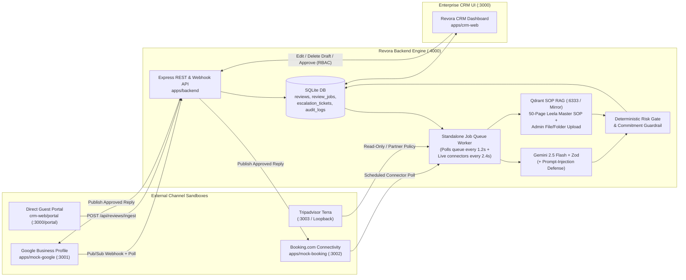

# Revora AI — Hospitality Review Reply Drafting & Reputation Governance CRM

> **Primary Property:** **THE LEELA PALACE BANGALORE** (`HOTEL001`, 23 HAL Old Airport Road, Bengaluru 560008)  
> **Sister Properties:** The Leela Goa (`HOTEL002`) · The Leela Palace Jaipur (`HOTEL003`)

Revora AI is a decoupled, policy-grounded hospitality review intelligence and CRM workflow platform. It ingests guest reviews from independent channel sandboxes (**Google Business Profile**, **Booking.com Connectivity**, **Tripadvisor Terra**, and the **Direct Guest Portal**), triages them asynchronously using **Gemini 2.5 Flash** + **Qdrant SOP RAG**, enforces deterministic safety/billing risk gates, and routes sensitive cases through **role-gated human approval** before publishing replies back to the originating platform.

---

## Architecture Overview



---

## Complete End-to-End Workflow

### 1. Channel Ingestion (Push, Poll & Portal)
Reviews enter Revora AI through channel-authentic transports without modifying core business logic:
- **Booking.com (`apps/mock-booking`, `:3002`):** Mimics `supply-xml.booking.com/review-api` (10-point scoring, `reservation_id`, bearer token auth, no webhooks). The standalone worker polls `GET /api/review-api/properties/:id/reviews` every ~2.4 seconds and deduplicates via `(platform, externalReviewId)` idempotency keys.
- **Google Business Profile (`apps/mock-google`, `:3001`):** Mimics GBP v4 Reviews API (5-star rating, Pub/Sub push notification to `POST /api/webhooks/google` + fallback polling).
- **Tripadvisor Terra (`:3003` / Loopback):** Respects partner API capability boundaries (`readReviews: true`, `publishReply: false` via `CapabilityNotSupportedError` unless authorized).
- **Direct Guest Portal (`http://localhost:3000/portal`):** Allows live demo submission directly into `POST /api/reviews/ingest`.

### 2. Asynchronous SQLite Job Queue & Standalone Worker
1. Incoming reviews are saved immediately to SQLite (`reviews`) and enqueued into `review_jobs` with an idempotency key (`ingest:<platform>:<externalReviewId>`).
2. The standalone worker (`apps/backend/src/worker/index.ts`) claims queued jobs atomically (`queued -> processing`), runs the AI + RAG + Risk Gate pipeline, and supports up to **3 retry attempts** with dead-letter visibility in the CRM **Job Queue** tab.

### 3. Live AI Triage (`gemini-2.5-flash` + Zod + Guardrails)
The analyzer (`apps/backend/src/ai/analyzer.ts`) sends the review wrapped in `<untrusted_guest_review>` tags to **Gemini 2.5 Flash** and validates the structured JSON output with **Zod**:
- Extracts `sentiment`, `primaryCategory`, `severity`, `allegations`, `customerIntent`, `recommendedDepartment`, `suggestedNextSteps`, `evidenceChecklist`, `draftReply`, `promptInjectionDetected`, and `containsRefundOrCompRequest`.
- **Prompt-Injection Defense:** Any instruction inside a review attempting to override policy or force refund approval is flagged (`promptInjectionDetected: true`) and ignored.
- **OTA Moderation Compliance:** Automatically strips external URLs, email addresses, and 10+ digit phone numbers from `draftReply` before publishing to Booking.com.
- Falls back cleanly to a deterministic local analyzer if the API key is unset or unreachable.

### 4. Qdrant SOP RAG & 50-Page Leela Palace Master Manual
Before routing or drafting final escalations, the engine queries the indexed SOP corpus (`apps/backend/src/rag/sopRag.ts`):
- **50-Page Master Manual:** `docs/sops/the-leela-palace-bangalore-master-sop-manual.md` (`SOP-LPB-MASTER-001`, 10 Parts, 96 numbered sections, ~21,122 words) plus focused departmental SOPs (`billing-and-refunds.md`, `safety-and-privacy.md`, `housekeeping-cleanliness.md`, `guest-service-routine.md`).
- **Vector Store:** Indexes chunks into **Qdrant (`:6333`)** when running, and automatically maintains a local vector mirror (`storage/qdrant/local-vectors.json`) for zero-dependency execution.
- **Admin SOP Upload:** Admins can upload individual `.md`/`.txt` SOP files or entire SOP folders directly in the CRM **SOP Knowledge** view (`POST /api/policies/upload`), which immediately chunks, embeds, and reindexes the RAG store.

### 5. Deterministic Risk Gate & Routing
Backend code (`apps/backend/src/engine/decisionEngine.ts`) always overrides LLM confidence:
- **Path 1 — Auto-Publish (Routine Praise):**  
  Triggered only when rating `>= 4`, sentiment is positive/routine, zero risk categories (`billing`, `safety`, `privacy`, `misconduct`, `cleanliness` <= 2★), no refund/compensation request, no prompt injection, `AUTO_PUBLISH_ROUTINE=true`, and the channel supports `publishReply`. The worker immediately publishes the reply back to the originating platform (e.g., Booking.com `:3002`).
- **Path 2 — Mandatory Escalation & Hold:**  
  Triggered by billing/overcharge disputes (e.g., `₹5,000` booked vs `₹6,200` charged), safety/DND/keycard/privacy/illness claims, staff misconduct, `<= 2★` ratings, refund requests, or prompt injection. Public reply stays **held (`reply: null` on the channel)** and an `escalation_tickets` briefing is created with SOP citations and an evidence checklist.

### 6. Customer Executive Review, Draft Edit/Delete & RBAC Approval
Inside the **Revora CRM Case Drawer** (`http://localhost:3000`):
- **5-Step Live Processing Pipeline:** Visualizes `Ingested -> AI Triage -> SOP RAG -> Risk Gate -> Published / Escalated`.
- **Evidence Checklist & SOP Citations:** Staff verify internal records (Opera PMS folio, VingCard lock logs, CCTV hold, FSSAI logs) and inspect exact SOP citations before publishing.
- **Executive Draft Editor (Edit & Delete Before Publish):** Customer executives can **edit** the Gemini-generated draft or **delete/clear the draft** completely (`DELETE /api/reviews/:id/draft` or `DELETE /api/escalations/:id/draft`) to compose a custom response prior to publication.
- **Commitment Guardrail:** Backend validation blocks public replies that promise unverified refunds, reimbursements, or monetary credits.
- **Server-Side RBAC (`X-Demo-Role`):**
  - `Support` — Routine review triage & draft editing (blocked from Finance/Safety escalation approvals and Admin actions).
  - `Finance` — Can approve/reject billing & refund escalations.
  - `Manager` — Can approve/reject operational, cleanliness, misconduct, and safety escalations.
  - `Admin` — Full escalation approval, Auto-Publish gate toggle, SOP file/folder upload, SOP reindex, and sandbox reset.
- Every state change, edit, draft deletion, blocked RBAC check, and publish action is written to `audit_logs`.

### 7. External Publication & Live Channel Sync
Once approved in the CRM, `POST /api/escalations/:id/approve` (or `POST /api/reviews/:id/approve`) dispatches the final reply through the platform connector:
- **Booking.com (`:3002`):** Posts to `POST /api/review-api/properties/:id/reviews/:review_id/replies` (`PENDING_MODERATION` -> `PUBLISHED` after 2s), appearing live as **Property response** on the Booking.com listing UI.
- **Google Business Profile (`:3001`):** Posts to the GBP v4 reply endpoint.

---

## Repository Structure

```text
Revora AI/
├── apps/
│   ├── backend/                 # Express API (:4000), SQLite job queue, Worker, Gemini & Qdrant RAG
│   ├── crm-web/                 # Next.js Enterprise CRM Dashboard & Guest Portal (:3000)
│   ├── mock-booking/            # Booking.com Connectivity Mock Website (:3002)
│   └── mock-google/             # Google Business Profile Mock Website (:3001)
├── packages/
│   └── shared/                  # CanonicalReview, Connector interface, RBAC matrix, Leela properties, seed data
├── docs/sops/                   # 50-page Leela Palace Master SOP + departmental SOPs
├── scripts/                     # Synthetic 50-page SOP generator (generate-leela-sop.mjs)
├── handoffs/                    # Teammate integration briefs for Google, Booking.com, Tripadvisor
└── docker-compose.yml           # Optional local Qdrant container (:6333)
```

---

## Quick Start (Local Demo)

1. **Install dependencies & configure environment:**
   ```bash
   npm install
   cp .env.example .env
   # Add your GEMINI_API_KEY in .env (or connect it from the CRM sidebar)
   ```

2. **Build workspace packages & seed SQLite + SOP vectors:**
   ```bash
   npm run build --workspace=packages/shared
   npm run build --workspace=apps/backend
   npm run seed
   ```

3. **Start all services:**
   ```bash
   # Terminal 1: Backend API (:4000)
   npm run start --workspace=apps/backend

   # Terminal 2: Standalone SQLite Job Queue + Live Connector Worker
   npm run start:worker --workspace=apps/backend

   # Terminal 3: Revora CRM Frontend (:3000)
   npm run dev --workspace=apps/crm-web

   # Terminal 4: Booking.com Mock (:3002)
   npm run dev --workspace=apps/mock-booking

   # Terminal 5 (Optional): Google Business Profile Mock (:3001)
   npm run dev --workspace=apps/mock-google
   ```

4. **Live Demo Walkthrough:**
   - Submit a **9.5/10 Routine Praise** or **3.0/10 Billing Dispute (₹5,000 vs ₹6,200)** on Booking.com (`http://localhost:3002`) or Google (`http://localhost:3001`).
   - Watch it arrive automatically in **Revora CRM (`http://localhost:3000`)**, review Gemini 2.5 Flash analysis and 50-page SOP citations, edit/delete the draft if needed, approve as `Finance` / `Manager`, and see the owner reply appear live on the source channel.
